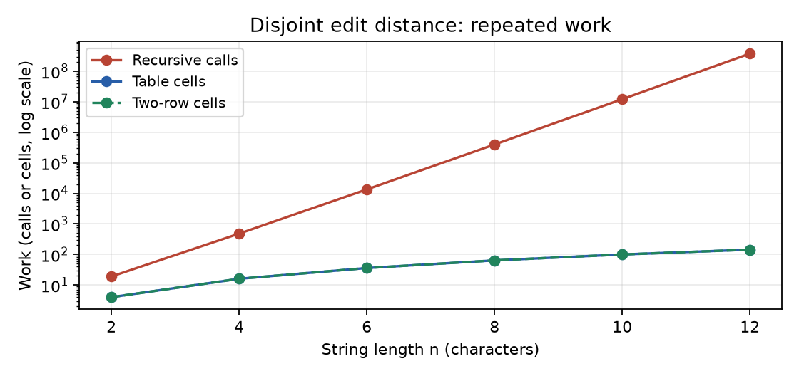
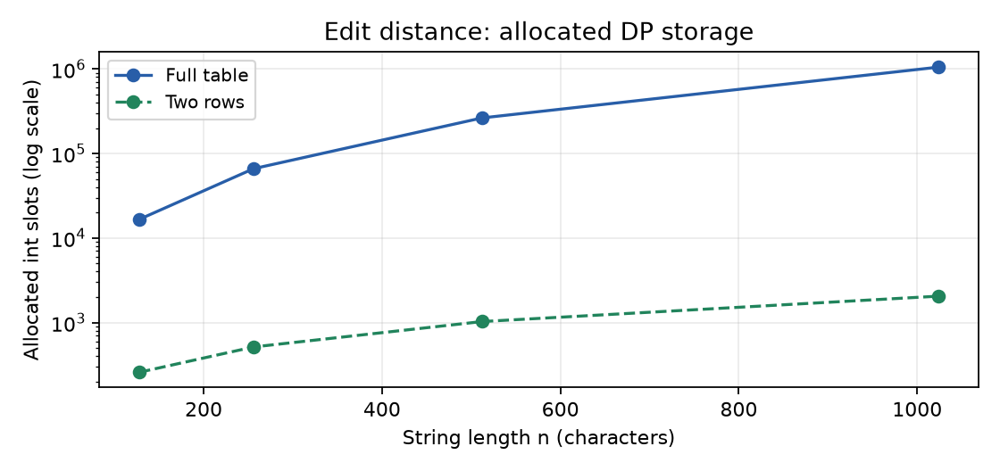
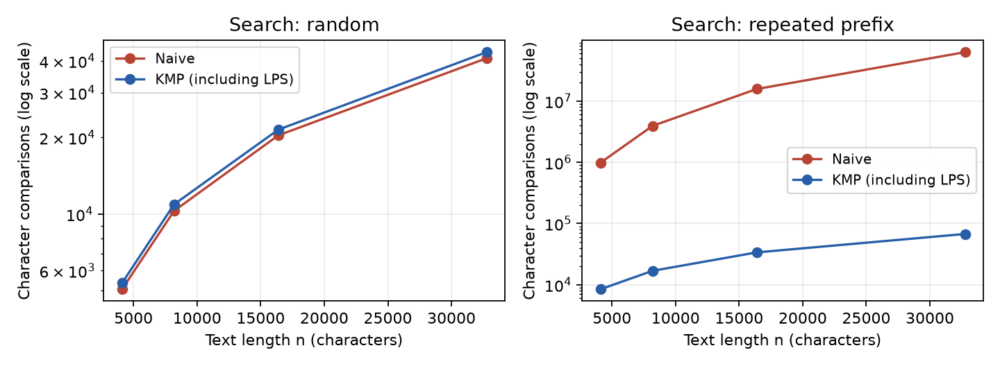
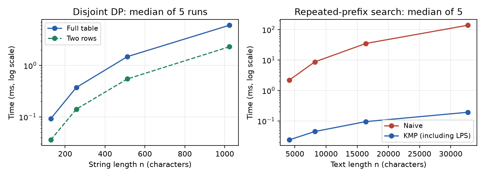

# Experiment Design Card

This card was written before running the experiment. Seed: **42**.

| Field | Plan |
|---|---|
| Questions | Edit distance: how quickly does repeated recursion grow compared with DP, and what memory does two-row DP save? Search: how does repeated-prefix input affect Naive and KMP? |
| Sizes | All edit versions: n = 2, 4, 6, 8, 10, 12, with both strings of length n. Table and two rows also use n = 128, 256, 512, 1024 to obtain useful timings. Search: text n = 4096, 8192, 16384, 32768 and pattern m = n/16. Each range spans at least a factor of four. |
| Edit inputs | Random strings over ABCD show ordinary small-alphabet inputs. Disjoint strings A^n and B^n force all three recursive branches at every non-base state. |
| Search inputs | Random text and pattern over ABCD usually reject a start quickly. Repeated-prefix text A^n and pattern A^(m-1)B force Naive to compare the entire pattern at every start. |
| Metrics | Median time in milliseconds from 5 runs after 3 warm-ups. Edit: recursive calls (including base cases), or interior DP cells. Search: character comparisons, including LPS construction for KMP. Count inside each algorithm. Also record peak DP array slots to show memory use without estimating JVM object overhead. |
| Prediction | Disjoint recursion grows exponentially; DP work grows quadratically. Two rows keep linear DP storage. Random search is close to linear, while the growing repeated-prefix pattern makes Naive quadratic and KMP stays linear. |
| Plots | 1. Disjoint edit work, log y-axis: recursion versus DP. 2. DP array slots: table versus two rows. 3. Search comparisons on both inputs: the repeated-prefix penalty. 4. Median times on larger inputs: how measured time relates to counters. |

Sizes are deliberately capped for recursion. The largest measured n is a chosen
experimental limit, not a claim about the machine's absolute limit. CSV contains
one row per measured call; warm-ups are excluded. Timing includes allocation and
counter updates, but excludes input generation and CSV writing. Exact times are
not reproducible; inputs, results and counters are.

## Results and plots

Environment: AMD Ryzen 5 5600H, Linux x86_64, OpenJDK 21, Gradle 9.1.0.
There are 340 measured runs (68 cases, five runs each). No changes were made
to the design card after the measurements.

The two DP lines overlap, while disjoint recursion reaches 377,393,953 calls
at n = 12 for only 144 interior cells in either DP version.

At n = 1024, two rows allocate 2,050 integer slots instead of 1,050,625,
about 512.5 times fewer slots.

Both methods stay close on random input, but at n = 32768 the repeated-prefix
case needs 62,916,608 Naive comparisons versus 67,582 for KMP.

On these larger inputs, the measured times follow the growth in work, and
two-row DP is faster than the table despite updating the same number of cells.

| Case | Algorithm | Median time (ms) | Counted work |
|---|---|---:|---:|
| Disjoint edit, n = 12 | Recursive | 769.897359 | 377,393,953 calls |
| Disjoint edit, n = 1024 | Table | 6.049023 | 1,048,576 cells |
| Disjoint edit, n = 1024 | Two rows | 2.310312 | 1,048,576 cells |
| Repeated-prefix search, n = 32768 | Naive | 138.466429 | 62,916,608 comparisons |
| Repeated-prefix search, n = 32768 | KMP | 0.192244 | 67,582 comparisons |

## Prediction versus result

**Edit distance.** The disjoint input confirms the prediction: from n = 10
to n = 12, recursive calls grow from 12,146,179 to 377,393,953, roughly 31 times.
DP counts are exactly n squared, because each interior cell is visited once.
Random recursion is not monotonic: n = 6 needs 4,185 calls but n = 8 only 59.
Equal characters take just the diagonal branch, so the particular strings matter,
not only their length. One random pair per size illustrates variation but does
not establish an average over all random strings.

**String search.** On repeated prefixes, an eightfold increase in n causes
about 64 times more Naive comparisons and eight times more KMP comparisons.
The pattern grows with n, so Naive's O(nm) becomes quadratic in this experiment;
with a fixed m it would be linear in n. On random input at n = 32768, Naive
uses 40,962 comparisons and KMP uses 43,283, including preprocessing.
KMP's advantage is reliable worst-case growth, not fewer comparisons on every input.

## Short answers

**Which search input was slowest, and why?** The repeated-prefix input was
slowest for Naive, reaching 138.466429 ms at n = 32768. At each start,
the A characters match until the final B fails, so the same text is checked again.
KMP uses the LPS array to retain the matching prefix and never moves its text
index backwards. Random input was actually slower than repeated prefixes for
KMP at the smallest sizes, so the Naive worst case is not a universal timing worst case.

**How large an n could recursive edit distance handle?** The largest tested
size was n = 12, where disjoint strings took about 770 ms per call.
The run completed; it did not crash or reach a measured hardware limit.
I stopped the experiment there because the call count already rose about
31 times between n = 10 and n = 12, making larger disjoint cases costly.
Repeated computation, rather than DP storage, was the practical obstacle.

**What do two rows gain and lose?** Two rows reduce extra DP storage from
O(nm) to O(m), while preserving O(nm) time and the same distance.
Only the previous and current rows are needed for each transition.
The full table makes it easy to trace back an actual sequence of edits.
With two rows, old states are lost, so recovering that sequence needs extra
work or a different reconstruction method.

**Which search would I choose for the city platform?** I would choose KMP
for long logs because its O(n + m) bound remains reliable on repeated text.
The LPS array costs O(m) extra memory and adds a preprocessing step.
Naive is simpler and can be sufficient for very short patterns, but its repeated
comparisons are a poor fit for long adversarial inputs. Exact search still does
not correct spelling: edit distance is the separate tool for typo suggestions.

## Measured time and limitations

The larger cases produced useful nonzero timings, but tiny cases were noisy:
random Naive search even fell from 0.573355 ms at n = 4096 to 0.370119 ms at
n = 32768 despite doing more comparisons. JVM compilation, CPU scheduling,
allocation and cache effects can influence time; three warm-ups do not remove
all of them, and these data do not isolate their individual effects.
Five-run medians reduce the effect of isolated outliers. Operation counts
are stronger evidence of growth, although a recursive call and a DP cell are
different units of work, so their ratio is not a speedup. `memory_cells` records
DP array slots only, excluding headers and the recursion stack; zero for search
means not measured, not zero memory. `result` is the distance for edit algorithms
and the match count for search. These generated search cases have no matches;
the tests separately check matching and overlapping patterns.
